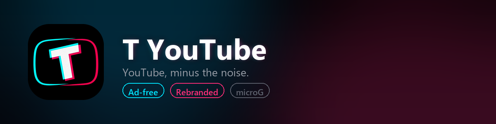
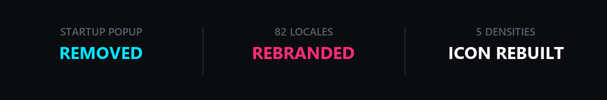
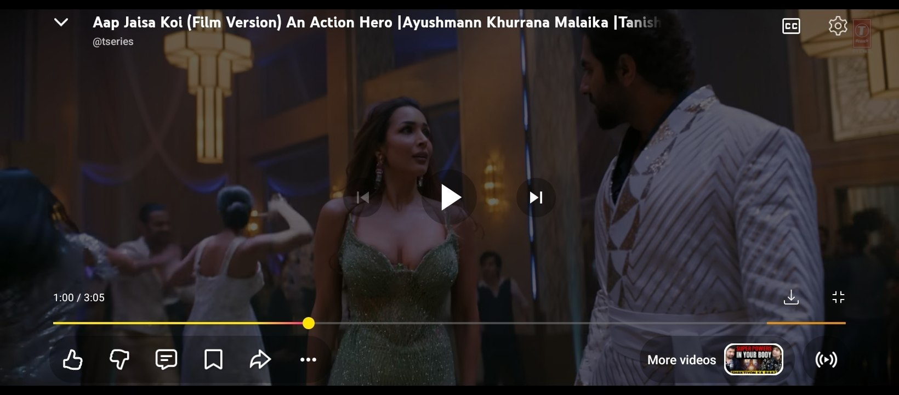
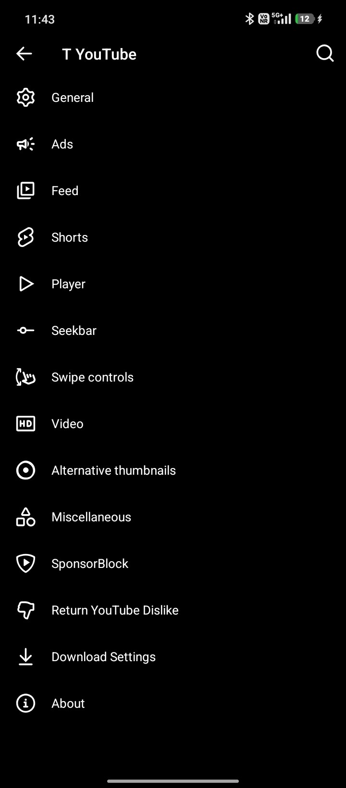
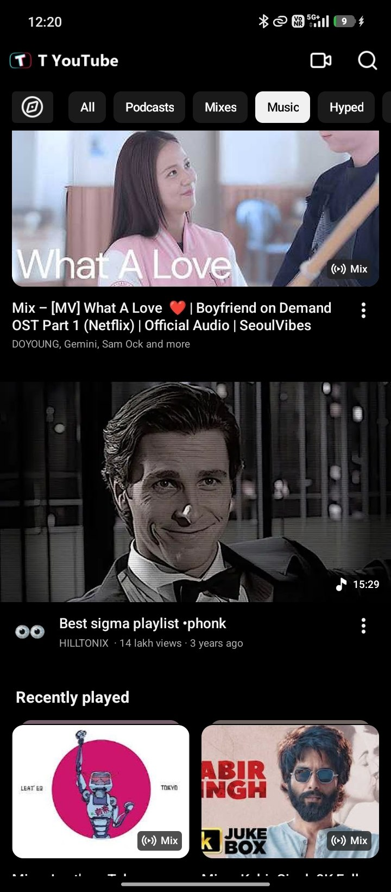
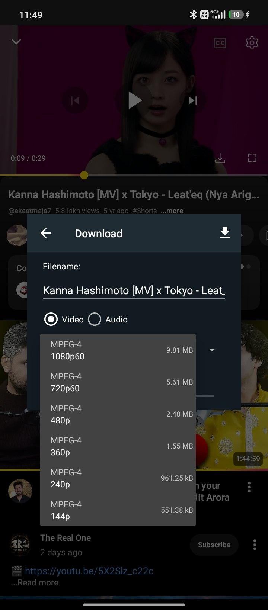
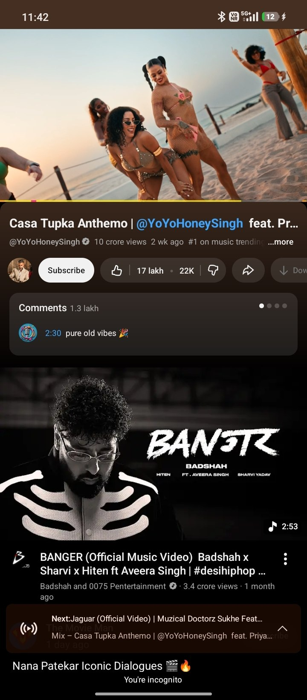

## Install Tutorial

**New here and just want it working?** Watch the screen recording, follow the
step-by-step, and check what each screen should look like.

<div align="center">
  <a href="https://engrtarun.github.io/T-YouTube/">
    
  </a>
</div>

<sub>› video · step-by-step · screenshots · troubleshooting · one-click downloads</sub>

---

<div align="center">
  

  ### Download

**One APK. microG is already inside it.** Install T YouTube, open it, and tap
**Start setup**. The app installs the bundled official MicroG-RE build for you.

  <a href="https://github.com/engrtarun/T-YouTube/releases">
    
  </a>

  <br>
  <sub>
    v1.2.0 bundles microG-RE 7.3.0 <b>-noicon</b> for arm64-v8a and armeabi-v7a.<br>
    Android shows one normal installer confirmation. Only T YouTube gets an icon.<br>
    Upgrading from v1.1.0? Install it over the old build; data stays.
  </sub>

  <br><br>

  [](https://github.com/engrtarun/T-YouTube/releases/latest)
  [](https://github.com/engrtarun/T-YouTube/releases)
  [](https://developer.android.com/)
  [](https://github.com/engrtarun/T-YouTube/releases/latest)
  [](https://github.com/MorpheApp/MicroG-RE)
  [](#-contributing)

  <sub>
    <a href="https://github.com/engrtarun/T-YouTube/releases">Release notes &amp; checksums</a> ·
    <a href="https://github.com/engrtarun/T-YouTube/releases/tag/v1.1.0">Previous stable v1.1.0</a>
  </sub>
</div>


---


---


---



---

## Screenshots

Captions describe the current **v1.2.0** build. The images are from the
v1.0.0 era, so a few details on screen differ from what ships today.

**Player** — one frame that shows three working features at once: the download
button, SponsorBlock, and Return-YouTube-Dislike.



**The rebrand, caught in the act** — both of these were taken on the v1.0.0
build, and both headers read **T YouTube**. On the base build this spot said
*"YouTube Pro"*, because the old name was baked into the app's header images.

<table>
<tr>
<td align="center" width="50%">
  
  <br><sub><b>Settings</b><br>Toolbar reads <b>T YouTube</b>;<br>the whole YT Pro patch menu is intact.</sub>
</td>
<td align="center" width="50%">
  
  <br><sub><b>Music tab</b><br>Rebuilt in-app wordmark —<br>T logo + “T YouTube” in the header.</sub>
</td>
</tr>
<tr>
<td align="center" width="50%">
  
  <br><sub><b>Downloader</b><br>Quality picker, 144p → 4K@60. The filename<br>opens with the real video title, a duplicate<br>is auto-renamed to <b>Title (1).mp4</b>, and tapping<br>the toolbar icon starts the download.</sub>
</td>
<td align="center" width="50%">
  
  <br><sub><b>Watch screen</b><br>Playback, comments, music player.<br>Fullscreen shows a small <b>T YouTube</b><br>mark in the control row.</sub>
</td>
</tr>
</table>

Shorts and the fullscreen watermark changed again in v1.2.0 but are not in these
images yet — see [issue #1](https://github.com/engrtarun/T-YouTube/issues/1)
and [issue #2](https://github.com/engrtarun/T-YouTube/issues/2).

---

## What this build changes

This is **not** a feature-addition fork. It is a *cleanup and rebrand* of
**YT Pro v59** — three deliberate changes, nothing else.

| # | Change | Details |
|:-:|:--|:--|
| 1 | **Startup ad/promo popup removed** | The mod fetches a remote JSON from a third-party server and pops an affiliate/promo dialog on every launch. Both code paths are stubbed to `return-void` at the entry point — no network request, no dialog, no background thread. |
| 2 |  **Full rebrand** | Every `YouTube Pro` string replaced with `T YouTube` across **all 82 locales**, plus settings screens and the launcher label — **and** the in-app wordmark images (40 PNG/WebP assets across five densities) where the old name was baked into *pixels*, which no text search can find. Zero occurrences remain. |
| 3 | **New icon set** | Purpose-built launcher icon built to the official Android adaptive-icon spec. |

**Not changed:** the package name, version code, or any patch/feature logic.
This build upgrades in place over the original and keeps your data, logins and
watch history.

---

## v1.2.0 — one app, microG included

**One download. One icon. microG installs itself on first run.** The official
MicroG-RE 7.3.0 `-noicon` APKs ship inside the T YouTube APK; the app picks the
right one for your phone and streams it into Android's installer. No second
download, no file manager, no manual install order.

| Change | What it does |
|:--|:--|
| **First-run setup** | Welcome → Start setup → checklist (microG / notifications / battery) → done. Every screen has **Later**, and relaunching never loops. When microG is already installed, the setup screen is skipped automatically and T YouTube opens directly. |
| **Bundled microG** | `microg-7.3.0-noicon-arm64-v8a.apk` and `...-armeabi-v7a.apk`, copied byte-for-byte from the official MorpheApp release. The app verifies size + SHA-256 while streaming and never re-signs or modifies them. |
| **One visible icon** | microG is a separate Android package because Android cannot merge it into another app, but its launcher alias is disabled (`-noicon`), so only T YouTube appears in the drawer. |
| **Settings → Setup & permissions** | New row above About. Reopens the checklist in manage mode if setup was skipped or microG was later uninstalled. |
| **No surprise browser** | The extension's old `checkGmsCore()` opened `https://morphe.software/microg` when microG was missing. It is now a no-op, so nothing can pop up behind setup. |
| **Issue #2: watermark** | Fullscreen **T YouTube** mark is now **11.5 sp at 0.55 alpha** (was 14 sp at 0.8). Still below the scrubber line, tied to controls visibility, absent inline/PiP/Shorts. |
| **Build marker** | About shows `Play Store Version 21.26.364 (v1.2.0)`. Package, version code (`2147483647`) and AOSP `testkey` signature are unchanged, so it installs over v1.1.0 with data intact. |

**[Download T YouTube v1.2.0](https://github.com/engrtarun/T-YouTube/releases)** ·
size and SHA-256 are published on the release page. Install it as an update —
do **not** uninstall the old app first.

Rollback: install [v1.1.0](https://github.com/engrtarun/T-YouTube/releases/download/v1.1.0/T-YouTube-v1.1.0.apk)
(or v1.0.1) over it. No data is lost; the hidden microG package can be removed
from Android Settings → Apps.

**Still included from v1.1.0:** the Shorts brand loop on every Shorts page, the
restored toolbar download button, automatic duplicate naming, and every v1.0.1
playback/download/theme fix.

YouTube links (optional): see
[Open YouTube links in T YouTube](#open-youtube-links-in-t-youtube). You can
skip it; nothing else depends on it.

Full change log for every build, including the withdrawn test-fix-4:
**[TEST-CHANGES.md](TEST-CHANGES.md)**.

Shorts/fullscreen branding specs:
**[TEST-UI-BRIEF.md](TEST-UI-BRIEF.md)**.

---

## Open YouTube links in T YouTube

Optional convenience. **Skip it if you prefer** — links keep opening in the
official YouTube app or your browser, exactly as before.

Android allows only **one** app per website. While the official YouTube app is
verified for `youtube.com`, T YouTube cannot take those links over silently —
Google already owns them. You hand them over once, in Android settings.

1. **Release the links from official YouTube** — Android Settings → Apps →
   **YouTube** → **Open by default** → turn off **Open supported links** (or
   remove `youtube.com` and `m.youtube.com` from the supported addresses).
2. **Give them to T YouTube** — Android Settings → Apps → **T YouTube** →
   **Open by default** → **Add link** → tick `youtube.com` and `m.youtube.com` →
   **Add**.
3. **Test** — open a youtube.com link from your browser or a chat app; Android
   should offer or open T YouTube.

Menu names vary slightly by phone maker (Samsung, Xiaomi, Pixel): look for
“Open by default”, “Default apps” or “Supported links” on the app info page.
Undo step 1 the same way if you change your mind.

---

## The icon

The previous icon was drawn at ~82 dp wide on a 108 dp canvas. Android only ever
shows a **72 dp** window of that canvas — so the neon ring was clipped by every
launcher mask. It looked broken.

This one is built to spec:

```
Canvas          108 dp
Masked window    72 dp   ← what the launcher actually shows
Safe zone        66 dp   ← artwork is fitted inside this circle, always
```

Built and previewed against circle, squircle and rounded-square masks at all
five densities (`mdpi` → `xxxhdpi`), plus the legacy square bitmap and the
Android 13+ **themed icon** (previously still showing the YouTube play glyph).

---

## Requirements

| | |
|:--|:--|
| **Android** | 10.0 (API 29) or newer |
| **Architecture** | `arm64-v8a` or `armeabi-v7a` for the bundled microG; the app itself is universal |
| **Google Play Services** | **Not required.** MicroG-RE can coexist with it; disabling it is only a troubleshooting step if sign-in misbehaves. |
| **microG-RE** | **Included.** v1.2.0 bundles the official 7.3.0 `-noicon` builds and installs one on first run. |
| **Free storage** | ~450 MB (app + microG install) |

---

## Installation

### Step 1 — Install T YouTube

1. Download the v1.2.0 APK from the releases page.
2. Open it and allow **"Install unknown apps"** for your browser/file manager.
3. Tap **Install**. If you already run v1.1.0, install it as an update; do not
   uninstall first.

### Step 2 — Open T YouTube and run setup

1. Tap the T YouTube icon.
2. Tap **Start setup**.
3. Android asks for **"Install unknown apps"** for T YouTube. This is the one
   permission the installer needs. Turn on **Allow from this source**.
4. Tap **Install** in Android's installer. The microG APK is already inside
   T YouTube, so there is no download.
5. Optionally turn on notifications and battery exemption. Both can be changed
   later.
6. Tap **Open T YouTube**.

That's it. Two packages are installed, but only T YouTube has a launcher icon.
microG's settings are reachable from T YouTube's settings.

### Manual microG install (fallback)

If you prefer to install microG yourself, or your phone is x86-only, use the
official builds from **https://github.com/MorpheApp/MicroG-RE/releases/latest**.
Pick the `-noicon` variant if you want the same hidden-icon setup. T YouTube
will detect it and skip the install step.

> **Signature spoofing:** MicroG-RE reads the spoof metadata already declared by
> T YouTube (`app.revanced.android.gms.SPOOFED_PACKAGE_NAME` and
> `...SPOOFED_PACKAGE_SIGNATURE`), so you do **not** need a system-level
> signature-spoofing patch. If a specific ROM still asks for it, enable it in
> microG-RE Settings → Signature spoofing for T YouTube.

> **Play Services:** current MicroG-RE coexists with Google Play Services. If
> sign-in fails with both installed, disable Play Services and try again. This
> is troubleshooting, not a required step.

---

## Upgrading from an older YT Pro build

Android refuses to install an update signed with a **different key**. T YouTube
is signed with the same AOSP `testkey` certificate that YT Pro v59 uses, so it
installs **directly over** it — no uninstall, your data stays.

```
package        com.gold.android.youtube
versionCode    2147483647
signature      SHA-256  a40da80a59d170caa950cf15c18c454d47a39b26989d8b640ecd745ba71bf5dc
```

### If you get `App not installed as package conflicts with an existing package`

That message means a **differently-signed** copy of the same package is already
installed. Common causes:

| Situation | What to do |
|:--|:--|
| A YT Pro build signed with a modder's own key | Uninstall it first ( clears app data) |
| A build signed with a random debug key | Uninstall it first |
| Any other fork of `com.gold.android.youtube` | Uninstall it first |

Reinstalling **this** build after that, and staying on this build for all future
updates, avoids the problem entirely.

---

## FAQ

<details>
<summary><b>Can it run alongside the official YouTube?</b></summary>

Yes. T YouTube uses the package `com.gold.android.youtube`, while the official
YouTube is `com.google.android.youtube`. Different packages — both can be
installed side by side. T YouTube talks to MicroG-RE through its spoofed Google
identity; real Play Services can stay installed. If sign-in misbehaves with both
present, disable Play Services and retry.
</details>

<details>
<summary><b>Does this remove in-video ads?</b></summary>

It removes the **mod's own startup promo/affiliate popup**. In-stream
advertising is served by YouTube's servers and is a separate matter.
</details>

<details>
<summary><b>Why does it say "MicroG Not Installed"?</b></summary>

microG is missing, turned off, or was uninstalled. Open
**Settings → Setup & permissions** in T YouTube and tap **Install**. In v1.2.0
the setup screen is the only place you need; it installs the microG copy bundled
inside the app. No browser or separate APK is involved.
</details>

<details>
<summary><b>Can I update later without losing data?</b></summary>

Yes — as long as future updates keep the same signing key, Android treats them
as an in-place update. Never re-sign with a random debug key; that is the single
most common cause of the conflict error above.
</details>

<details>
<summary><b>Why was this signed with the AOSP test key?</b></summary>

Because that is the key the original YT Pro v59 is signed with, and Android
requires a matching key to install over an existing app. The AOSP `testkey`
certificate is a publicly published test certificate from the Android Open
Source Project — it is not a secret, and it grants no special privileges.
</details>

<details>
<summary><b>Is this safe?</b></summary>

It is a modified YouTube client. It is not distributed by, affiliated with, or
endorsed by Google. See [Legal](#-legal--disclaimer).
</details>

---

## Technical details

| Property | Value |
|:--|:--|
| Package name | `com.gold.android.youtube` |
| Version name | `21.26.364` |
| Version code | `2147483647` |
| Min SDK | 29 (Android 10) |
| Target SDK | 37 |
| APK size | ≈300 MB in v1.2.0 (includes two microG APKs); exact size in the release notes |
| Entry count | 16,827 |
| Signature scheme | APK Signature Scheme **v3** |
| Signing certificate | AOSP `testkey` — `CN=Android, O=Android, L=Mountain View, ST=California, C=US` |
| Cert SHA-256 | `a40da80a59d170caa950cf15c18c454d47a39b26989d8b640ecd745ba71bf5dc` |
| Cert SHA-1 | `61ed377e85d386a8dfee6b864bd85b0bfaa5af81` |

### Verify before you install

```powershell
# signature
apksigner verify --print-certs T-YouTube-v1.2.0.apk

# checksum
Get-FileHash T-YouTube-v1.2.0.apk -Algorithm SHA256
```

The release page publishes the SHA-256 for every build. Stable v1.1.0 stays
available as a rollback with the same signing key.

**SHA-256 for v1.1.0 (stable)**

```
337f55a17c8fdd1ae458a4ab9e76ca3bd1335c3865ca0bb5de055fd078496d5c
```

**SHA-256 for v1.0.1 (previous stable)**

```
71B0F782702129A0DDCC80EE0A7150F52FE0099671AB62692766B1C605EBE7FE
```

---

## How it was built

```
YT Pro v59 (original APK)
        │
        ├─ apktool 2.9.3  d  →  decode to smali + res
        │
        ├─ patch ①  com.apksam.task.DevMsg.showMessage()  → return-void
        ├─ patch ②  com.sammods4h.task.DevMsg.show()      → return-void
        │            (both are the remote-config promo dialog entry points)
        │
        ├─ patch ③  res/values*/strings.xml  →  83 files, "YouTube Pro" → "T YouTube"
        ├─ patch ④  adaptive + legacy + themed icons rebuilt to spec
        ├─ patch ⑤  in-app action-bar logo → T mark
        ├─ patch ⑥  40 wordmark PNG/WebP rebuilt (the app header still said
        │            "YouTube Pro" because that text lives inside images)
        │
        ├─ apktool 2.9.3  b  →  rebuild
        ├─ zipalign -p -f 4
        └─ apksigner sign --ks testkey.p12   (AOSP testkey, scheme v3)
```

The rebuild was verified **byte-identical across all 10 `classes*.dex` files**
versus the known-good build, confirming the runtime patches survived reassembly.

### v1.2.0 build pipeline

Everything heavy runs on GitHub Actions; the maintainer machine never decodes
the 212 MB base APK.

1. Download stable v1.0.1 and verify its SHA-256.
2. Download the official MicroG-RE 7.3.0 `-noicon` APKs (arm64-v8a and
   armeabi-v7a), verify both SHA-256 values and the signing certificate.
3. Decode v1.0.1 with apktool, then run `scripts/apply-zversion.py` (Shorts,
   downloads, watermark, build marker) and `scripts/apply-one-app.py`
   (manifest, bundled assets, settings row, no-op `checkGmsCore`).
4. Compile `setup-src/` with `javac --release 8` and `d8 --min-api 29` into a
   single setup dex, then add it to the rebuilt APK as `classes11.dex`.
5. Zipalign, sign with the AOSP testkey, and run `ci/test-one-app.py` against
   the decoded tree, the setup dex and the signed APK before uploading.
6. Publish the artifact; a `test-v1.2.0-*` tag also creates a prerelease.

---

## Maintainer

<a href="https://github.com/engrtarun">
  
  <br>
  <b>@engrtarun</b>
</a>

---

## Contributing

Issues and pull requests are welcome — especially translations, bug reports with
logs, and icon refinements for other launcher shapes.

Please do **not** open issues for ad-blocking or account problems; those are
server-side / microG-side concerns.

---

## Support this project

If T YouTube saved you a download or some time, a star genuinely helps -
it is the only signal GitHub uses to rank a repository, and it is what this
project has instead of ad revenue.

<div align="center">

[](https://github.com/engrtarun/T-YouTube/stargazers)
[](https://github.com/engrtarun/T-YouTube/fork)
[](https://github.com/engrtarun/T-YouTube/watchers)

</div>

**Why it matters**

| Instead of | Try this |
|:--|:--|
| Nothing | Press **Star** - takes one click, costs nothing |
| Spreading a link that dies | Press **Fork** - you get your own copy to change freely |
| Reporting a bug later | Press **Watch** - you get notified when a new update ships |

**Share it with one person who got stuck installing.** That is worth more than
a hundred stars: it is the difference between someone giving up and someone
getting it working. The hardest part of this project is not the code, it is
that nobody finds modified YouTube builds unless somebody tells them.

<sub>Star if it helped. Fork if you want to make it yours.</sub>

---

## Legal & Disclaimer

T YouTube is an **unofficial, community-made modification** of the YouTube
Android client. It is not affiliated with, endorsed by, sponsored by, or
otherwise connected to Google LLC or YouTube.

- "YouTube" is a trademark of Google LLC. The name is used here only to describe
  what this software is a modification of.
- The APK contains copyrighted Google code and is published for educational and
  interoperability purposes only.
- **No source code is provided for the YouTube client itself.** The original
  authors and copyright holders retain all rights to it.
- microG-RE is a separate project (a GmsCore fork, **Apache-2.0**). Starting with
  v1.2.0, its official 7.3.0 `-noicon` APKs are redistributed **unmodified**
  inside the T YouTube APK with attribution. The license text ships in the app
  at `assets/licenses/microg-RE.txt` and the source is available at
  [MorpheApp/MicroG-RE](https://github.com/MorpheApp/MicroG-RE).
- You are responsible for complying with the laws in your jurisdiction.

---

## Credits

| | |
|:--|:--|
| **YT Pro v59** | The base build this is forked from — the patch set, downloader and feature work are theirs |
| **microG-RE** | The Google Play Services replacement this runs on — [MorpheApp/MicroG-RE](https://github.com/MorpheApp/MicroG-RE) |
| **apktool** | Used for decode / patch / rebuild — [iBotPeaches/Apktool](https://github.com/iBotPeaches/Apktool) |
| **Android Open Source Project** | The `testkey` signing certificate is a publicly published AOSP test certificate |
| **You** | For the bug reports and translations |

---

<div align="center">
  <sub>
    Not affiliated with Google ·
    <a href="https://github.com/engrtarun/T-YouTube/issues">Report an issue</a> ·
    <a href="https://github.com/engrtarun/T-YouTube/releases">All releases</a>
  </sub>
</div>